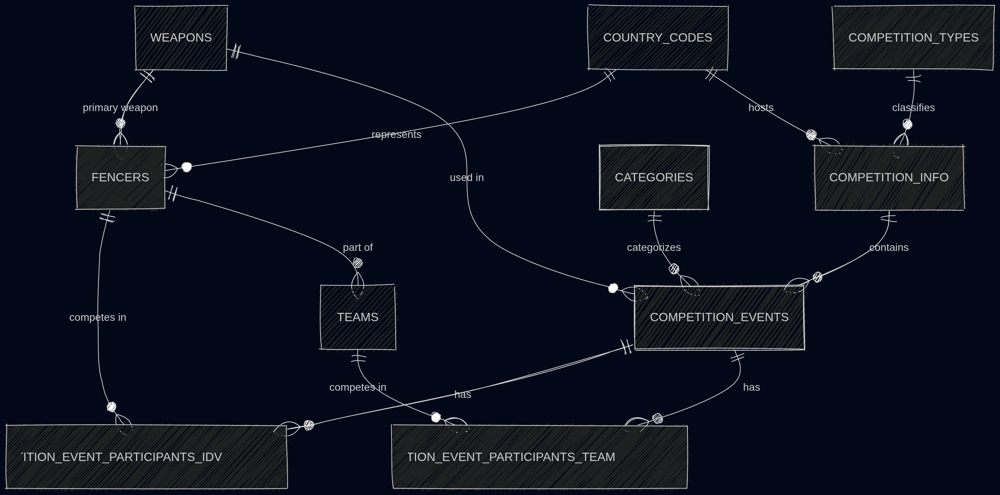

# Design Document

By Sofeyah Amira

## Scope

The Fencing Database includes all entities necessary to facilitate the process of storing fencers and fencing competitions, with a focus on past competitions. As such, included in the database's scope is:

* Fencers, including basic identifying information
* Competitions, including basic identifying information
* Competition Events, which are the events in any given competions
* Competition Results, for every competiton event

Out of scope are elements like live tracking.

## Functional Requirements

This database will support:

* CRUD operations for fencers, competitions and results

## Representation

Entities are captured in SQLite tables with the following schema.

### Entities

The database includes the following entities:

#### Fencers

The `fencers` table includes:

* `id`, which specifies the unique ID for the fencer as an `INTEGER`. This column thus has the `PRIMARY KEY` constraint applied.
* `first_name`, which specifies the fencer's first name as `TEXT`, given `TEXT` is appropriate for name fields.
* `last_name`, which specifies the fencer's last name. `TEXT` is used for the same reason as `first_name`.
* `weapon_id`, which specifies the ID of the weapon the fencer primarily plays as an `INTEGER`. This column thus has the `FOREIGN KEY` constraint applied, referencing the `id` column in the `weapons` table.
* `age`, which specifies the age of the fencer as of the date this project was created (2026) as an `INTEGER`.
* `country code`, which  specifies the code of the country that the fencer represents as `CHAR` with a capacity of 3 characters. This column has the `FOREIGN KEY` constraint applied, referencing the `code` column in the `countries` table.
* `sex`, which specifies the fencers sex as either male or female as a `CHAR` with a capacity of 1 character, M for Male, F for Female.

All columns in the `fencers` table are required and hence should have the `NOT NULL` constraint applied. No other constraints are necessary.

#### Teams

The `team`s table includes:

* `id`, which specifies the unique ID for the team as an `INTEGER`. This column thus has the `PRIMARY KEY` constraint applied.
* `fencer1_id`, which specifies the ID for the first fencer in the team as an `INTEGER`. This column thus has the `FOREIGN KEY` constraint applied, referencing the `id` column in the `fencers` table.
* `fencer2_id`, which specifies the ID for the first fencer in the team as an `INTEGER`, This column thus has the `FOREIGN KEY` constraint applied for the same reasons as `fencer1_id`.
* `fencer3_id`, which specifies the ID for the first fencer in the team as an `INTEGER`, This column thus has the `FOREIGN KEY` constraint applied for the same reasons as `fencer1_id`.
* `fencer4_id`, which specifies the ID for the first fencer in the team as an `INTEGER`, This column thus has the `FOREIGN KEY` constraint applied for the same reasons as `fencer1_id`.
* `country code`, which  specifies the code of the country that the team represents as `CHAR` with a capacity of 3 characters. This column has the `FOREIGN KEY` constraint applied, referencing the `code` column in the `countries` table.

All columns in the `teams` table are required and hence should have the `NOT NULL` constraint applied. No other constraints are necessary. The only exception is the `fencer4_id` as a fourth fencer is often a spare/extra player which not all teams have.

#### Competition Info

The `competition_info` table includes:

* `id`, which specifies the unique ID for the competition as an `INTEGER`. This column thus has the `PRIMARY KEY` constraint applied.
* `competition_name`, which specifies the name of the competition as a `TEXT`.
* `competition_start_date`, which defines the date the competition starts, it thus has the `DATE` type.
* `competition_end_date`, which defines the date the competition ends, it thus has the `DATE` type.
* `country code`, which  specifies the code of the host country as `CHAR` with a capacity of 3 characters. This column has the `FOREIGN KEY` constraint applied, referencing the `code` column in the `countries` table.
* `competition_type_id`, which specifies the ID of the competition type as an `INTEGER`. This column thus has the `FOREIGN KEY` constraint applied, referencing the `id` column in the `competition_types` table.

All columns in the `competition_info` table are required, and hence should have the `NOT NULL` constraint applied. No other constraints are necessary.

#### Competition Events

The `competition_events` table includes:

* `id`, which specifies the unique ID for the competition event as an `INTEGER`. This column thus has the `PRIMARY KEY` constraint applied.
* `competition_id`, which is the ID of the competition that the event belongs to as an `INTEGER`. This column thus has the `FOREIGN KEY` constraint applied, referencing the `id` column in the `competition_info` table to ensure data integrity.
* `category_id`, which is the ID of the age category of the event as an `INTEGER`. This column thus has the `FOREIGN KEY` constraint applied, referencing the `id` column in the `categories` table to ensure data integrity.
* `team_event`, which specifies wether the competition event is a team of individual event using a `BOOL` where 0 or `FALSE` is individual and 1 or `TRUE` is team
* `sex`, which specifies the sex category of the event as either male or female as a `CHAR` with a capacity of 1 character, M for Male, F for Female.
* `weapon_id`, which specifies the ID of the weapon for the event as an `INTEGER`. This column thus has the `FOREIGN KEY` constraint applied, referencing the `id` column in the `weapons` table.

All columns in the `competition_events` table are required, and hence should have the `NOT NULL` constraint applied. No other constraints are necessary.

#### Competition Event Results (Individual)

The `competition_event_results_idv` table includes:

* `id`, which specifies the unique ID for the submission as an `INTEGER`. This column thus has the `PRIMARY KEY` constraint applied.
* `competition_event_id`, which specifies the ID of the competition event that the results are for as an `INTEGER`. This column thus has the `FOREIGN KEY` constraint applied, referencing the `id` column in the `competition_events` table.
* `fencer_id` which specifies the ID of the fencer who the result belongs to as an `INTEGER`. This column thus has the `FOREIGN KEY` constraint applied, referencing the `id` column in the `fencers` table.
* `rank` which specifies the placement rank of the fencer in the event as an `INTEGER`. 1 for first place, 2 for second, etc.

All columns are required and hence have the `NOT NULL` constraint applied where a `PRIMARY KEY` or `FOREIGN KEY` constraint is not.

#### Competition Event Results (Team)

The `competition_event_results_team` table includes:

* `id`, which specifies the unique ID for the submission as an `INTEGER`. This column thus has the `PRIMARY KEY` constraint applied.
* `competition_event_id`, which specifies the ID of the competition event that the results are for as an `INTEGER`. This column thus has the `FOREIGN KEY` constraint applied, referencing the `id` column in the `competition_events` table.
* `team_id` which specifies the ID of the team who the result belongs to as an `INTEGER`. This column thus has the `FOREIGN KEY` constraint applied, referencing the `id` column in the `teams` table.
* `rank` which specifies the placement rank of the fencer in the event as an `INTEGER`. 1 for first place, 2 for second, etc.

All columns are required and hence have the `NOT NULL` constraint applied where a `PRIMARY KEY` or `FOREIGN KEY` constraint is not.

### Relationships

The below entity relationship diagram describes the relationships among the entities in the database.

As detailed by the diagram:
A fencer can only primarily play one weapon and represent 1 country. They can compete in many competitions and be a part of many teams.
A team must have distinct fencers and each team can compete in many team competition events while each team competition event must have distinct teams.
A competition can only have 1 type and one country associated with it. A competition can have many events
A competition event can only have 1 weapon category per event, 1 age category per event, and be related to one competition per event.
A competition event can have multiple participants.

## Optimizations

Per the typical queries in `queries.sql`, it is common for users of the database to access details of all fencers. For that reason, indexes are created on the `country_code`, `weapon_id`, and `sex` columns to speed the identification of students by those columns.

Similarly, it is also common practice for a user of the database to concerned with viewing all competition events. As such, an index is created on the `competition_id`, `category_id`, `weapon_id` columns in the `competition_events` table to speed the identification competition events.

Users may also look through team members, therefore indexes are created in the `teams` table for all four fencers.
